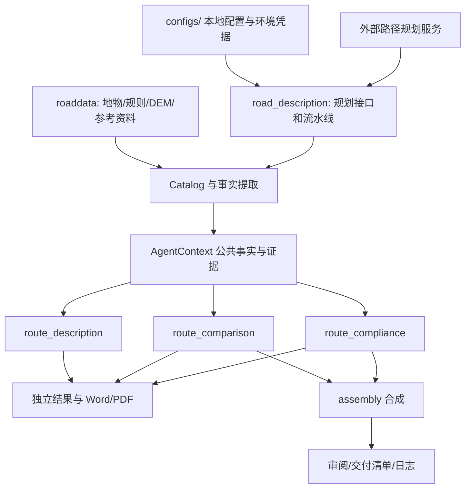

# 开发分工、依赖与文件职责

## 三个人分别从哪里开始

| 负责人 | 主要编辑目录 | 输入与输出边界 | 重点测试 |
| --- | --- | --- | --- |
| 路径描述 | `report_agents/route_description/`；描述实现当前复用 `road_description/pipeline.py`、`narrative.py`、`document.py`、`presentation.py` | 已选两条路线与 GIS 事实 → 3.3.1/3.3.2 的叙述、图件、Word/PDF | `test_facts.py`、`test_document.py`、`test_reference_presentation.py` |
| 方案比选 | `report_agents/route_comparison/agent.py` | 公共事实及测量、专业资料 → 3.3 总体方案及比选；复用描述段落 | `test_agents.py`、`test_rich_case.py` |
| 合规分析 | `report_agents/route_compliance/` | 路线与约束、跨越、专业资料 → 3.4.8—3.4.11、3.5 | `test_chapter_delivery.py`、`test_source_review.py` |

每个人先读根 README、自己的 Agent README、本说明和公共 `AgentContext`。个人范围只做描述时，不需要修改另外两个插件。当前并非三个完全独立安装包：描述 Agent 仍复用核心流水线，比选/合规共享公共事实与版式。这些共享部分修改时需要通知另外两位并跑全套测试，不能宣称零耦合。

独立执行方式见根 README。插件入口统一为类属性 `manifest` 与 `run(ctx)`，注册表中维护 ID 到入口类的映射。`run` 返回包含 `status`、`documents` 等字段的结果字典，由 runner 统一写结果与来源。新增插件应通过注册表接入，不在别的插件中直接调用它的实现。

## 数据和代码怎么连接

- 规划 API 负责产生路线；报告侧的 GIS 测量与原规则共同形成事实，模型只组织表达和审阅。
- `runner` 用 `load_context` 统一校验地图、数据、路线版本后调度所选插件；不让每个 Agent 自己猜坐标或复制一套规则。
- `common/` 不依赖具体插件；同事之间通过事实包、材料结构和结果结构协作。优先在自己的目录修改章内业务逻辑，需要新增公共字段时统一约定并测试。
- `assembly` 拼装比选和合规内容，路径描述已被比选复用，避免另加一次重复描述。合成依赖章标题/段落结构，修改标题编号时必须跑章节验收。
- 历史 `outputs/` 不是源码，不作为插件间隐式固定依赖。所有读写输出路径由同一个项目配置指定；`outputs/latest` 仅是发布展示，不用于继续生成。
- 数据文件与接口地址均来自配置。规划器源码是可选佐证，不是插件 import 依赖；外部后端仍必须提供规划接口或已有归档响应。

## 根目录与配置

| 路径 | 用途 |
| --- | --- |
| `README.md` | 安装、运行、API配置与开发入口 |
| `configs/config.example.json` | 三 Agent 全流程示例；无真实接口地址与密钥 |
| `configs/config.description.example.json` | 仅个人负责的描述章节；关闭报告合成 |
| `configs/config.local.json` | clone 后自行复制并填写，不提交；其他实际 config 同样忽略 |
| `.env.example` / `.env` | 空凭据字段说明 / 自行填写的本地凭据；只有 example 提交 |
| `requirements.txt` / `requirements-lock.txt` | 兼容依赖范围 / 历史验证环境版本记录 |
| `.gitignore` | 排除数据、密钥、实际配置、归档、缓存、历史输出；最新样例按文件白名单放行 |
| `roaddata/` | 本地数据，只有放置说明提交 |
| `templates/` | Word基础模板；不能作为没用的二进制删掉 |
| `assets/` | 参考页眉图片；运行时可能从原稿提取生成 |
| `outputs/latest/` | 唯一发布报告样例 |
| `outputs/` 其他子目录 | 本地运行证据与产物，不提交 |
| `local_archive/` | 历史文档、配置备份、迁移日志与本地验证记录，不提交 |
| `.venv/`、`.tools/`、`.secrets/` | 本地环境、Office安装、凭据，不提交 |

## 核心模块

| 文件（位于 road_description/） | 职责 |
| --- | --- |
| `__init__.py`、`__main__.py` | 包与 CLI 入口 |
| `pipeline.py` | 组织读数据、提事实、叙述、图片、文档、插件和审阅；描述插件用 description_only 避免递归调用 |
| `planner.py` | 规划 HTTP 客户端、轮询、选取方案、错误处理 |
| `automatic_routes.py` | 同一起终点不同控制点尝试，筛选两条真实不同路线 |
| `facts.py` | Catalog、坐标转换、地名与几何事实提取、南北配对 |
| `map_snapshot.py` | 地图快照与增删改还原，保持规划证据一致 |
| `source_layers.py` | 补充 GDB、来源指纹；不修改规划器输入 |
| `narrative.py` | 描述提示与结构化事实约束、模型/模板叙述 |
| `model_runtime.py` | 模型适配、独立凭据读取、限流重试和用量记录 |
| `presentation.py` | 主要跨越事件选择、普通乡道压缩、参考样式筛选 |
| `figures.py` | 路线总图、区域高亮与局部图件 |
| `browser_basemap.py` | 浏览器底图获取；依赖外部地图服务可用性 |
| `materials.py` | 照片/素材确认、路线绑定与来源核验 |
| `document.py` | Word样式、表格/图件插入、LibreOffice导出及PDF检查 |
| `quality_review.py` | 文本、页面与一致性模型审阅及证据记录 |
| `runlog.py` | 运行事件与进度日志 |
| `io.py` | JSON、哈希、project_root 配置路径解析、公开归档脱敏与地图压缩 |
| `service.py`、`service.html` | 本地报告任务 API、排队取消下载、浏览器页面 |

## 插件框架与公共模块

| 文件（位于 report_agents/） | 职责 |
| --- | --- |
| `__init__.py`、`__main__.py` | 包与独立插件 CLI |
| `registry.py` | 插件ID注册与实例化 |
| `runner.py` | 加载公共上下文、选定插件执行、保存结果及交付状态 |
| `assembly.py` | 合成完整报告；非第四Agent |
| `delivery.py` | 交付索引、缺失项和完成度汇总 |
| `common/context.py` | AgentContext、路线/地图/资料哈希一致性与补充资料绑定 |
| `common/gis.py` | 各插件共享的长度、约束、生态、DEM等测量 |
| `common/environment.py` | 风冰分区与沿线地形高程指标 |
| `common/coverage.py` | 数据覆盖与章节证据完整性 |
| `common/specialists.py` | 地形交通军事矿产生态等专业输入与推荐意见 |
| `common/supplement.py` | 专项调查、协议、跨越设计等补充记录 |
| `common/report.py` | 共享 Word 段落、表格、图件、审阅和来源呈现 |
| `route_description/agent.py` | 包装核心描述流水线，给出描述插件结果 |
| `route_comparison/agent.py` | 比选指标、总图、对比表与受证据约束的推荐 |
| `route_compliance/agent.py` | 合规章节组织、跨越及停电等分析 |
| `route_compliance/profiles.py` | 跨越/高程示意图 |
| `route_compliance/reference_scenes.py` | 按参考章节组织代表性跨越场景 |
| `materials.example.json`、`supplemental.example.json` | 素材与补充资料字段格式，空值不是已确认事实 |

各子目录 `__init__.py` 仅作为包入口；各 README 是对应开发与运行说明。

## 测试和工具逐文件索引

工具分成通用准备/审计与历史联调脚本；后者会读取原场景输出或实际接口，有些会规划、编辑隔离会话地图或调用模型。先阅读脚本参数和顶部说明再运行，不把整目录当成无副作用的单测命令。

| tools/ 文件 | 职责 |
| --- | --- |
| `audit_data.py` | 数据与字段覆盖审计。 |
| `audit_delivery.py` | 章节、证据、文件及可选在线接口审计。 |
| `audit_source_mapping.py` | 地物来源和属性映射审计。 |
| `build_acceptance_fixture.py` | 构造显式标注为测试的专业资料验收样本。 |
| `check_acceptance_results.py` | 核验上述专项样本输出。 |
| `check_reference_delivery.py` | 参考精简版与基线对照验收。 |
| `check_rich_delivery.py` | 多跨越场景报告验收。 |
| `check_setup.py` | 通用：检查本地配置、文件、图层、渲染器和凭据存在性；不调用模型。 |
| `check_source_review.py` | 补充源数据使用情况验收。 |
| `final_acceptance.py` | 历史综合验收与审阅；依赖历史配置/产物，可能调用模型。 |
| `measure_report_run.py` | 通用：读取运行日志、统计token/耗时并写汇总；不重新生成。 |
| `plan_demo.py` | 历史演示规划入口，会调用外部规划服务；需匹配配置。 |
| `prepare_office.py` | Linux本地Office依赖准备，下载至忽略目录。 |
| `reconcile_review_labels.py` | 基于证据复核审阅标签；可能调用模型。 |
| `select_rich_route_candidates.py` | 调用规划接口筛选多跨越演示路线。 |
| `soffice_local.sh` | 本地Office启动包装器。 |
| `verify_delta_workflow.py` | 历史地图编辑增量报告工作流验收。 |
| `verify_map_edits.py` | 实际规划服务隔离会话的地图增删改与重放一致性核验。 |
| `verify_project_job.py` | 实际项目/任务接口联调。 |
| `verify_report_service.py` | 报告服务任务、日志、下载、取消等接口联调。 |

| tests/ 文件 | 职责 |
| --- | --- |
| `test_agents.py` | 插件注册、共用测量与资料逻辑。 |
| `test_chapter_delivery.py` | 章节交付、DEM缺失值与工程证据。 |
| `test_completion.py` | 专业资料、来源、服务任务和完成度。 |
| `test_document.py` | Word/PDF结构和图片排版。 |
| `test_facts.py` | 事实提取、坐标与几何关系。 |
| `test_live_workflow.py` | 快照增量、任务流程和凭据脱敏（受控模拟）。 |
| `test_model_adapter.py` | 模型API兼容、JSON与usage记录。 |
| `test_reference_presentation.py` | 参考风格内容筛选和图表组织。 |
| `test_rich_case.py` | 多跨越与命名场景。 |
| `test_setup.py` | 缺数据预检、凭据隐藏及服务相对路径解析。 |
| `test_source_review.py` | 补充数据、生态边界和专业来源。 |

共享模块变更后运行 `python -m pytest -q`。不将 API 密钥、真实地址、本机绝对路径、业务原始数据加入代码或测试；测试采用合成或隔离临时文件。
